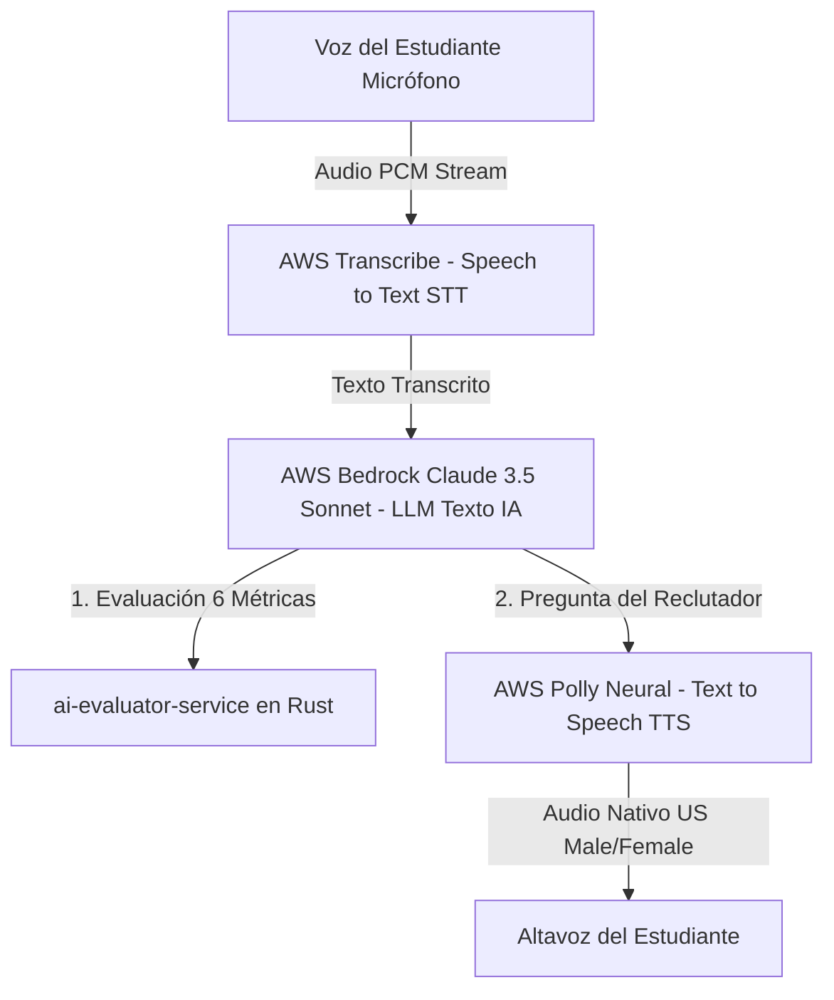
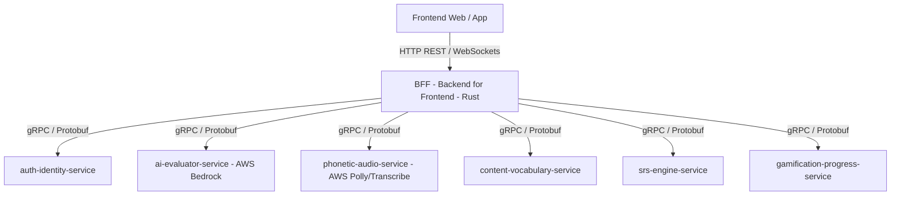
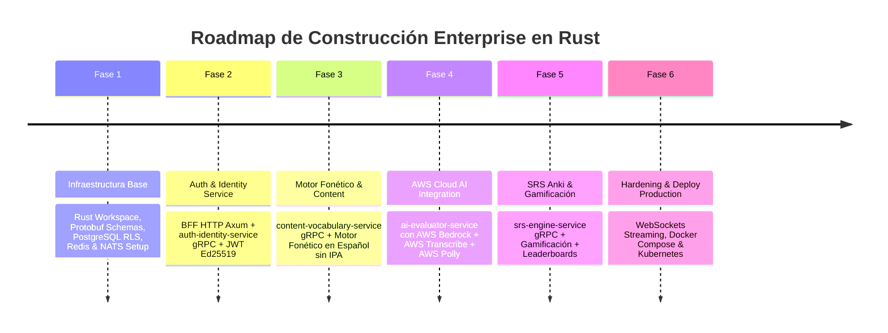

# 🏛️ DOCUMENTO MAESTRO DE ARQUITECTURA ENTERPRISE: DevFluency AI
**DDD + Clean Architecture + BFF Pattern + gRPC + Rust + AWS Cloud AI (Bedrock + Polly + Transcribe) + PostgreSQL RLS**

---

## 📌 TABLA DE CONTENIDOS
1. [Visión del Producto & Filosofía Pedagógica Inversa](#1-visión-del-producto--filosofía-pedagógica-inversa)
2. [Motor de Fonética Natural en Español (Sin IPA / Sin AFI)](#2-motor-de-fonética-natural-en-español-sin-ipa--sin-afi)
3. [Sistema de Vocabulario en Contexto (5,000 - 8,000 Términos Tech)](#3-sistema-de-vocabulario-en-contexto-5000---8000-términos-tech)
4. [Estructura de Contenidos por Niveles y Situaciones Reales (A0 a C1)](#4-estructura-de-contenidos-por-niveles-y-situaciones-reales-a0-a-c1)
5. [Módulo Especializado: Tech & System Design Interviews](#5-módulo-especializado-tech--system-design-interviews)
6. [Motor de Evaluación IA & Examen de 6 Métricas (90% Pass Rate Target)](#6-motor-de-evaluación-ia--examen-de-6-métricas-90-pass-rate-target)
7. [Arquitectura AWS Cloud AI (Bedrock + Transcribe + Polly)](#7-arquitectura-aws-cloud-ai-bedrock--transcribe--polly)
8. [Diseño UX/UI & Sistema de Gamificación Avanzada](#8-diseño-uxui--sistema-de-gamificación-avanzada)
9. [Patrón de Arquitectura: DDD + Clean Architecture en Microservicios Rust](#9-patrón-de-arquitectura-ddd--clean-architecture-en-microservicios-rust)
10. [Arquitectura de Comunicación: BFF + gRPC + NATS JetStream](#10-arquitectura-de-comunicación-bff--grpc--nats-jetstream)
11. [Estrategia de Seguridad & Validación de Inputs (Defensa en Profundidad)](#11-estrategia-de-seguridad--validación-de-inputs-defensa-en-profundidad)
12. [Seguridad Multi-Tenant y Aislamiento de Datos por Cliente](#12-seguridad-multi-tenant-y-aislamiento-de-datos-por-cliente)
13. [Modelo de Base de Datos Relacional (PostgreSQL DDL + RLS Policies)](#13-modelo-de-base-de-datos-relacional-postgresql-ddl--rls-policies)
14. [Mapeo de Caché y Estructuras en Redis Cluster](#14-mapeo-de-caché-y-estructuras-en-redis-cluster)
15. [Roadmap Exhaustivo de Implementación Fase por Fase (Fase 1 a Fase 6)](#15-roadmap-exhaustivo-de-implementación-fase-por-fase-fase-1-a-fase-6)
16. [Matriz de Diferenciación Objetiva frente a Duolingo](#16-matriz-de-diferenciación-objetiva-frente-a-duolingo)

---

## 1. VISIÓN DEL PRODUCTO & FILOSOFÍA PEDAGÓGICA INVERSA

### 1.1. El Problema de la Enseñanza Tradicional
Los cursos tradicionales enseñan gramática y reglas sintácticas antes de hablar. Esto causa traducción mental consciente e incapacidad para comunicarse en reuniones técnicas.

### 1.2. Principio Inverso: Natural Language Acquisition
DevFluency AI replica el proceso natural de adquisición del lenguaje:

$$\text{1. Escuchar} \longrightarrow \text{2. Repetir} \longrightarrow \text{3. Asociar} \longrightarrow \text{4. Hablar} \longrightarrow \text{5. Comprender} \longrightarrow \text{6. Gramática (Al final)}$$

---

## 2. MOTOR DE FONÉTICA NATURAL EN ESPAÑOL (SIN IPA / SIN AFI)

### 2.1. Regla de Oro Fonética
**Prohibido el uso de símbolos fonéticos IPA o AFI como `/dɪˈvɛləpər/`.** Toda oración utiliza transliteración léxica natural en español con tildes de intensidad sonora.

### 2.2. Formato Obligatorio de Presentación de Frases:

```text
🇺🇸 Inglés
I'm developing software in Rust.

🔊 Pronunciación para Hispanohablantes
Aim divélopin sofgüer in rast.

🇪🇸 Traducción
Estoy desarrollando software en Rust.
```

---

## 3. SISTEMA DE VOCABULARIO EN CONTEXTO (5,000 - 8,000 TÉRMINOS TECH)

Para cada término, se almacenan **3 a 5 oraciones conversacionales reales** con fonética y traducción:

```json
{
  "word": "developer",
  "spanish_phonetic": "divéloper",
  "translation": "desarrollador",
  "category": "programming",
  "level": "A1-A2",
  "context_sentences": [
    {
      "en": "I'm a backend developer.",
      "ph": "Aim a bákend divéloper.",
      "es": "Soy un desarrollador backend."
    },
    {
      "en": "We need a senior Rust developer.",
      "ph": "Güi nid a sínior rast divéloper.",
      "es": "Necesitamos un desarrollador Rust senior."
    },
    {
      "en": "The developer fixed the production bug.",
      "ph": "Da divéloper fíkst da prodákshon bag.",
      "es": "El desarrollador corrigió el error de producción."
    }
  ]
}
```

---

## 4. ESTRUCTURA DE CONTENIDOS POR NIVELES Y SITUACIONES REALES (A0 A C1)

| Nivel | Situaciones de la Vida Real | Módulos Profesionales / Tech |
| :--- | :--- | :--- |
| **A0** | Saludos básicos, Números, Alfabeto fonético | Herramientas dev (Slack, Zoom, Git) |
| **A1** | Restaurante, Hotel, Aeropuerto, Presentación personal | "Tell me about yourself", Equipos de trabajo |
| **A2** | Viajes, Trabajo diario, Videollamadas básicas | Daily Standup, Reporte de tareas y bloqueos |
| **B1** | Discusión de tareas, Explicación de bugs | Code Reviews, Comentarios en Pull Requests |
| **B2** | Presentaciones técnicas, Resolución de conflictos | System Design, Microservicios vs Monolito, AWS/Docker |
| **C1** | Negociación de contratos, Liderazgo técnico | Entrevistas de Liderazgo, Arquitectura Enterprise |

---

## 5. MÓDULO ESPECIALIZADO: TECH & SYSTEM DESIGN INTERVIEWS

1. **Tell Me About Yourself**: Pitch personal en 90 segundos.
2. **Technologies & Stack**: Explicación de elecciones técnicas (Rust vs Go, PostgreSQL vs NoSQL).
3. **Architecture & Microservices**: Latencia, patrones de diseño y escalabilidad.
4. **Debugging & Emergency Incidents**: Explicar incidentes en producción (Datadog, rollback, hotfix).
5. **DevOps & Cloud Ecosystem**: AWS Lambda, Kubernetes, Docker y CI/CD pipelines.

---

## 6. MOTOR DE EVALUACIÓN IA & EXAMEN DE 6 MÉTRICAS (90% PASS RATE TARGET)

$$\text{Score Total} = (0.20 \times \text{Listening}) + (0.20 \times \text{Pronunciación}) + (0.20 \times \text{Fluidez}) + (0.15 \times \text{Vocabulario}) + (0.15 \times \text{Conversación}) + (0.10 \times \text{Gramática})$$

* **Puntaje Mínimo de Aprobación**: **$\ge 90.0\%$**.
* **Diagnóstico Quirúrgico**: Si el alumno obtiene < 90%, la IA **aísla las 2 métricas más débiles** y genera automáticamente un **Dril de Refuerzo Personalizado de 20 minutos**.

---

## 7. ARQUITECTURA AWS CLOUD AI (BEDROCK + TRANSCRIBE + POLLY)

La inteligencia artificial se divide estrictamente según la especialización del modelo dentro del ecosistema de **AWS Cloud**:



### 7.1. IA de Texto: AWS Bedrock Runtime (`aws-sdk-bedrockruntime`)
* **Modelo**: `anthropic.claude-3-5-sonnet-20241022-v2:0` o `amazon.titan-text-express-v1`.
* **Función**:
  * Simula al reclutador / Tech Lead de EE. UU. con preguntas dinámicas e inesperadas.
  * Evalúa la matriz de las **6 Métricas** y genera la rutina de refuerzo de 20 minutos.
  * Convierte oraciones dinámicas en fonética natural en español.

### 7.2. IA de Audio STT (Voz a Texto): AWS Transcribe (`aws-sdk-transcribe-streaming`)
* **Modelo**: AWS Transcribe Streaming (English US `en-US`).
* **Función**: Transcribe el flujo de audio del estudiante en tiempo real, detectando vacilaciones, tiempos de silencio y pronunciación de palabras clave.

### 7.3. IA de Audio TTS (Texto a Voz Nativa): AWS Polly (`aws-sdk-polly`)
* **Modelo**: AWS Polly Neural Voices (`Matthew`, `Joanna`, `Ruth`).
* **Función**: Sintetiza las preguntas del reclutador en audio estéreo de alta definición con entonación natural de hablante nativo de EE. UU.

---

## 8. DISEÑO UX/UI & SISTEMA DE GAMIFICACIÓN AVANZADA

* **Estética Premium**: Dark Mode inspirada en Linear / Raycast / Cursor (`#0B0D13` fondo, `#141722` tarjetas).
* **Gamificación**: XP, Rachas (Streaks) 🔥, Monedas Tech 💎, Corazones/Energía, Logros 🏆 y Leaderboards.

---

## 9. PATRÓN DE ARQUITECTURA: DDD + CLEAN ARCHITECTURE EN MICROSERVICIOS RUST

```text
src/
├── domain/                  # Entidades (User, ExamSession), Value Objects, Traits
├── application/             # Use Cases (RegisterUser, EvaluateExamAnswer)
├── infrastructure/          # AWS SDKs (Bedrock, Polly, Transcribe), SQLx, Redis, NATS
└── presentation/            # Servidores gRPC (tonic), Interceptores
```

---

## 10. ARQUITECTURA DE COMUNICACIÓN: BFF + gRPC + NATS JETSTREAM



---

## 11. ESTRATEGIA DE SEGURIDAD & VALIDACIÓN DE INPUTS

* **Cero Confianza (Zero Trust)**: Validación de inputs en UI (Zod), gRPC Interceptors en Rust y Objetos de Valor auto-validados en el dominio.

---

## 12. SEGURIDAD MULTI-TENANT Y AISLAMIENTO DE DATOS POR CLIENTE

* **PostgreSQL Row Level Security (RLS)** nativo para aislamiento estricto por cliente (`user_id`).
* Tokens JWT asimétricos Ed25519.

---

## 13. MODELO DE BASE DE DATOS RELACIONAL (POSTGRESQL DDL + RLS POLICIES)

```sql
CREATE EXTENSION IF NOT EXISTS "uuid-ossp";

CREATE TABLE users (
    id UUID PRIMARY KEY DEFAULT uuid_generate_v4(),
    email VARCHAR(255) UNIQUE NOT NULL,
    password_hash VARCHAR(255) NOT NULL,
    full_name VARCHAR(100) NOT NULL,
    target_role VARCHAR(50) DEFAULT 'Software Developer',
    current_level VARCHAR(10) DEFAULT 'A1',
    created_at TIMESTAMP WITH TIME ZONE DEFAULT CURRENT_TIMESTAMP
);

CREATE TABLE vocabulary_words (
    id UUID PRIMARY KEY DEFAULT uuid_generate_v4(),
    word VARCHAR(100) NOT NULL,
    spanish_phonetic VARCHAR(150) NOT NULL,
    spanish_translation VARCHAR(150) NOT NULL,
    category VARCHAR(50) NOT NULL,
    level VARCHAR(10) NOT NULL,
    frequency_score FLOAT DEFAULT 1.0,
    created_at TIMESTAMP WITH TIME ZONE DEFAULT CURRENT_TIMESTAMP
);

CREATE TABLE context_sentences (
    id UUID PRIMARY KEY DEFAULT uuid_generate_v4(),
    word_id UUID REFERENCES vocabulary_words(id) ON DELETE CASCADE,
    english_text TEXT NOT NULL,
    spanish_phonetic TEXT NOT NULL,
    spanish_translation TEXT NOT NULL,
    audio_url TEXT,
    created_at TIMESTAMP WITH TIME ZONE DEFAULT CURRENT_TIMESTAMP
);

CREATE TABLE user_srs_progress (
    id UUID PRIMARY KEY DEFAULT uuid_generate_v4(),
    user_id UUID REFERENCES users(id) ON DELETE CASCADE,
    sentence_id UUID REFERENCES context_sentences(id),
    easiness_factor FLOAT DEFAULT 2.5,
    interval_days INT DEFAULT 1,
    repetitions INT DEFAULT 0,
    next_review TIMESTAMP WITH TIME ZONE DEFAULT CURRENT_TIMESTAMP,
    CONSTRAINT unique_user_sentence UNIQUE (user_id, sentence_id)
);

CREATE TABLE ai_exam_sessions (
    id UUID PRIMARY KEY DEFAULT uuid_generate_v4(),
    user_id UUID REFERENCES users(id) ON DELETE CASCADE,
    level_target VARCHAR(10) NOT NULL,
    score_listening FLOAT NOT NULL,
    score_pronunciation FLOAT NOT NULL,
    score_fluency FLOAT NOT NULL,
    score_vocabulary FLOAT NOT NULL,
    score_grammar FLOAT NOT NULL,
    score_conversation FLOAT NOT NULL,
    total_score FLOAT NOT NULL,
    passed BOOLEAN NOT NULL,
    detected_weaknesses JSONB,
    created_at TIMESTAMP WITH TIME ZONE DEFAULT CURRENT_TIMESTAMP
);

ALTER TABLE user_srs_progress ENABLE ROW LEVEL SECURITY;
ALTER TABLE ai_exam_sessions ENABLE ROW LEVEL SECURITY;

CREATE POLICY srs_user_isolation ON user_srs_progress
    FOR ALL USING (user_id = current_setting('app.current_user_id')::uuid);

CREATE POLICY exam_user_isolation ON ai_exam_sessions
    FOR ALL USING (user_id = current_setting('app.current_user_id')::uuid);
```

---

## 14. MAPEO DE CACHÉ Y ESTRUCTURAS EN REDIS CLUSTER

```text
session:user:{user_id} -> Hash { "token": "...", "role": "dev" }
ratelimit:bff:{ip}:{endpoint} -> Counter (TTL 60s)
cache:polly:audio:{sha256_text} -> Audio Bytes (S3/CloudFront URL)
```

---

## 15. ROADMAP EXHAUSTIVO DE IMPLEMENTACIÓN FASE POR FASE (FASE 1 A FASE 6)



---

## 16. MATRIZ DE DIFERENCIACIÓN OBJETIVA FRENTE A DUOLINGO

| Característica | Duolingo | DevFluency AI |
| :--- | :--- | :--- |
| **Audiencia Objetivo** | Público general | Desarrolladores e ingenieros tech hispanohablantes |
| **Relevancia de Frases** | Vocabulario infantil | 100% Empleabilidad ("I'll deploy the hotfix to AWS") |
| **IA de Texto** | Estática / Prompt simple | AWS Bedrock (Claude 3.5 Sonnet / Titan) |
| **IA de Audio** | Sintetizador genérico | AWS Polly Neural (STT) + AWS Transcribe (TTS) |
| **Guía de Pronunciación** | Inexistente en texto | Fonética natural en español con tildes en cada oración |
| **Evaluación Conversacional** | Ejercicios rígidos | IA adaptativa con preguntas impredecibles de entrevista |
| **Gestión de Errores** | Obliga a repetir todo el nivel | Genera rutinas quirúrgicas de 20 min solo para áreas débiles |
| **Arquitectura Backend** | Monolítica/Servicios varios | BFF (HTTP) + Microservicios Rust (gRPC) + AWS Cloud AI |
