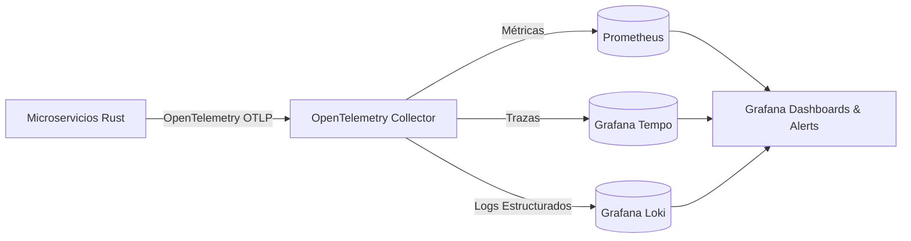

# 🧪 GUÍA DE TESTING Y OBSERVABILIDAD BACKEND: DevFluency AI (Microservicios Rust)

---

## 📌 PARTE 1 — ESTRATEGIA DE TESTING BACKEND

### 1.1 Pruebas Unitarias en Capa de Dominio (`cargo test`)
* **Qué es**: Pruebas puras sin red ni base de datos para verificar la lógica de negocio aislada.
* **Aplicación en DevFluency AI**:
  * Matriz de cálculo del Examen IA (ponderación de las 6 métricas: Listening 20%, Pronunciación 20%, Fluidez 20%, Vocabulario 15%, Conversación 15%, Gramática 10%).
  * Verificación del algoritmo Anki SM-2 (cálculo de intervalos de repetición espaciada y easiness factor).
  * Validaciones de Value Objects (`ScoreMetric`, `PhoneticText`, `Email`).
* **Regla**: Se ejecutan en milisegundos. Cobertura obligatoria del 100% en `domain/` y `application/`.

### 1.2 Pruebas de Integración con `testcontainers-rs`
* **Qué es**: Verificación de interacción real entre microservicios Rust, PostgreSQL 16 con RLS, Redis y NATS JetStream.
* **Aplicación en DevFluency AI**:
  * Probar que las políticas PostgreSQL RLS bloquean consultas entre diferentes `user_id`.
  * Probar consumo y publicación de eventos en NATS JetStream (ej. `UserPassedExamEvent`).
  * Probar almacenamiento y expiración de sesiones en Redis.

### 1.3 Property-Based Testing (`proptest`)
* **Qué es**: Generación masiva de datos aleatorios para encontrar errores en bordes no previstos.
* **Aplicación en DevFluency AI**:
  * Inyectar textos arbitrarios en el motor fonético para verificar que jamás entre en `panic!`.
  * Generar combinaciones aleatorias de notas de exámenes y asegurar que el cálculo total siempre está acotado entre `0.0%` y `100.0%`.

### 1.4 Pruebas de Contrato gRPC (`tonic`)
* **Qué es**: Validación estricta de esquemas Protobuf entre el BFF y los microservicios internos.
* **Aplicación en DevFluency AI**:
  * Garantizar que cambios en `.proto` no rompan la compatibilidad binaria de servicios de producción.

### 1.5 Chaos Engineering y Resiliencia (`turmoil` / `madsim`)
* **Qué es**: Inyección simulada de caídas de red, latencia y caídas súbitas de nodos.
* **Aplicación en DevFluency AI**:
  * **Crash Monkey**: Muerte instantánea de una réplica de `ai-evaluator-service` durante un examen en vivo.
  * **Partition Monkey**: Corte de red entre NATS y el servicio de gamificación para verificar almacenamiento en buffer.

---

## 🔭 PARTE 2 — OBSERVABILIDAD Y TELEMETRÍA

### 2.1 Stack Operacional Obligatorio

### 2.2 Métricas RED (Requests, Errors, Duration)
Cada endpoint HTTP del BFF y servicio gRPC expone automáticamente:
* `http_requests_total{service="bff", status="200"}`
* `grpc_request_duration_seconds_bucket{service="ai-evaluator", method="EvaluateExam"}`
* Presupuesto de latencia: **P99 < 50ms** en BFF, **P99 < 10ms** en gRPC interno.

### 2.3 Correlación de Trazas (`trace_id`)
Cada petición entrante al BFF genera un `trace_id` inmutable que se propaga vía cabeceras gRPC metadata a través de todos los microservicios Rust y eventos de NATS.
