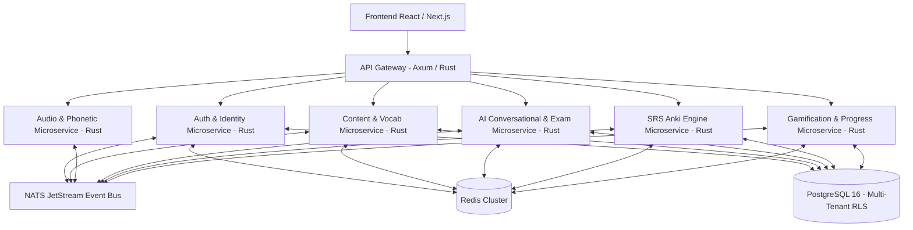

# 🚀 ROADMAP & ARQUITECTURA ENTERPRISE EN RUST: DevFluency AI
**Plataforma de Inglés Conversacional para Desarrolladores Hispanohablantes**

---

## 📌 1. Visión Pedagógica y Filosofía Inversa

### Principio Fundamento: Natural Learning First
El aprendizaje imita la adquisición de la lengua materna:
$$\text{Escuchar} \longrightarrow \text{Repetir} \longrightarrow \text{Asociar} \longrightarrow \text{Hablar} \longrightarrow \text{Comprender} \longrightarrow \text{Gramática (Al final)}$$

---

### 🔊 Característica Core: Fonética Natural en Español (Sin IPA / Sin AFI)
Toda frase en inglés debe presentarse obligatoriamente con su fonética adaptada para hispanohablantes (usando tildes de intensidad sonora y sin símbolos fonéticos complejos):

```text
🇺🇸 Inglés
I'm developing software in Rust.

🔊 Pronunciación para Hispanohablantes
Aim divélopin sofgüer in rast.

🇪🇸 Traducción
Estoy desarrollando software en Rust.
```

---

### 📚 Vocabulario en Contexto Práctico (5,000 - 8,000 Términos Tech)
No se enseñan palabras aisladas. Para cada término, la base de datos almacena la palabra clave junto a **3 a 5 oraciones conversacionales reales** con su fonética y traducción:

* **Palabra**: `Developer` | 🔊 **divéloper** | 📖 Desarrollador
  1. 🇺🇸 *I'm a backend developer.* $\rightarrow$ 🔊 **Aim a bákend divéloper.** $\rightarrow$ 🇪🇸 Soy un desarrollador backend.
  2. 🇺🇸 *We need a senior Rust developer.* $\rightarrow$ 🔊 **Güi nid a sínior rast divéloper.** $\rightarrow$ 🇪🇸 Necesitamos un desarrollador Rust senior.
  3. 🇺🇸 *The developer fixed the production bug.* $\rightarrow$ 🔊 **Da divéloper fíkst da prodákshon bag.** $\rightarrow$ 🇪🇸 El desarrollador corrigió el error de producción.

---

## 🤖 2. Motor de Evaluación IA Adaptativa & Examen de 6 Métricas

### Examen Dinámico (90% Pass Rate Target)
La IA no utiliza preguntas predefinidas ni estáticas. Salta de tema inesperadamente (*"Tell me about your experience with Rust"*, *"Why choose microservices over a monolith?"*, *"What do you do on weekends?"*) para medir improvisación real.

#### Matriz de Ponderación de Competencia:
$$\text{Score Total} = (0.20 \times \text{Listening}) + (0.20 \times \text{Pronunciación}) + (0.20 \times \text{Fluidez}) + (0.15 \times \text{Vocabulario}) + (0.15 \times \text{Conversación}) + (0.10 \times \text{Gramática})$$

---

## 🏗️ 3. Arquitectura de Microservicios en Rust



---

### 📦 3.1. Descomposición de Microservicios en Rust

#### 1. `auth-identity-service` (Rust + Axum + Jwt Ed25519)
* **Responsabilidad**: Gestión de usuarios, autenticación, OAuth2, emisión de tokens JWT asimétricos y aislamiento de sesión.
* **Seguridad**: Hash de contraseñas con Argon2id, tokens firmados con llaves privadas Ed25519.

#### 2. `content-vocabulary-service` (Rust + Axum + SQLx)
* **Responsabilidad**: Gestión del banco de 8,000+ palabras y frases en contexto por niveles (A0 a C1) y situaciones reales (Standups, PR Reviews, System Design, HR Interviews).

#### 3. `phonetic-audio-service` (Rust + Axum + Whisper + Web Audio)
* **Responsabilidad**: Transliteración fonética natural al español, streaming de audio TTS (Text-to-Speech) y procesamiento de voz STT (Speech-to-Text).

#### 4. `ai-evaluator-service` (Rust + Tokio + Gemini API / OpenAI)
* **Responsabilidad**: Motor del reclutador virtual IA. Genera preguntas inesperadas, evalúa las 6 métricas y genera la rutina personalizada de 20 minutos.

#### 5. `srs-engine-service` (Rust + Tokio)
* **Responsabilidad**: Algoritmo de repetición espaciada Anki SM-2 optimizado en Rust para máxima velocidad de cálculo en millones de tarjetas.

#### 6. `gamification-progress-service` (Rust + Redis + SQLx)
* **Responsabilidad**: Control de XP, Rachas (Streaks), Monedas, Niveles, Logros y Leaderboards globales.

---

## 🔒 4. Seguridad Multi-Tenant y Aislamiento de Datos

Para garantizar que **ningún usuario pueda ver o acceder a los datos de otro**, se implementan 3 capas de seguridad en profundidad:

### 1. PostgreSQL Row Level Security (RLS)
Cada tabla del sistema habilita políticas RLS nativas en la base de datos:

```sql
-- Habilitar RLS en la tabla de progreso del usuario
ALTER TABLE user_progress ENABLE ROW LEVEL SECURITY;

-- Crear política de aislamiento estricto por user_id
CREATE POLICY user_progress_isolation_policy ON user_progress
    FOR ALL
    USING (user_id = current_setting('app.current_user_id')::uuid);
```

### 2. Autenticación Asimétrica EdDSA (Ed25519 JWT)
Los microservicios validan la identidad del cliente mediante llaves públicas de JWT sin necesidad de consultar la base de datos en cada petición HTTP.

### 3. Isolation & Rate Limiting con Redis ACLs
Uso de cuotas independientes en Redis Token Bucket para evitar ataques DDoS o abuso de la API por usuario.

---

## 🗄️ 5. Modelo de Base de Datos Relacional (PostgreSQL DDL)

```sql
-- Extensión para UUIDs
CREATE EXTENSION IF NOT EXISTS "uuid-ossp";

-- 1. Tabla de Usuarios
CREATE TABLE users (
    id UUID PRIMARY KEY DEFAULT uuid_generate_v4(),
    email VARCHAR(255) UNIQUE NOT NULL,
    password_hash VARCHAR(255) NOT NULL,
    full_name VARCHAR(100) NOT NULL,
    target_role VARCHAR(50) DEFAULT 'Software Developer',
    current_level VARCHAR(10) DEFAULT 'A1',
    created_at TIMESTAMP WITH TIME ZONE DEFAULT CURRENT_TIMESTAMP
);

-- 2. Banco de Vocabulario en Contexto
CREATE TABLE vocabulary_words (
    id UUID PRIMARY KEY DEFAULT uuid_generate_v4(),
    word VARCHAR(100) NOT NULL,
    spanish_phonetic VARCHAR(150) NOT NULL,
    spanish_translation VARCHAR(150) NOT NULL,
    category VARCHAR(50) NOT NULL, -- 'programming', 'standup', 'system-design'
    level VARCHAR(10) NOT NULL,    -- 'A1', 'B2', 'C1'
    created_at TIMESTAMP WITH TIME ZONE DEFAULT CURRENT_TIMESTAMP
);

CREATE TABLE context_sentences (
    id UUID PRIMARY KEY DEFAULT uuid_generate_v4(),
    word_id UUID REFERENCES vocabulary_words(id) ON DELETE CASCADE,
    english_text TEXT NOT NULL,
    spanish_phonetic TEXT NOT NULL,
    spanish_translation TEXT NOT NULL,
    audio_url TEXT
);

-- 3. Progreso de Repetición Espaciada (Anki SM-2)
CREATE TABLE user_srs_progress (
    id UUID PRIMARY KEY DEFAULT uuid_generate_v4(),
    user_id UUID REFERENCES users(id) ON DELETE CASCADE,
    sentence_id UUID REFERENCES context_sentences(id),
    easiness_factor FLOAT DEFAULT 2.5,
    interval_days INT DEFAULT 1,
    repetitions INT DEFAULT 0,
    next_review TIMESTAMP WITH TIME ZONE DEFAULT CURRENT_TIMESTAMP
);

-- 4. Exámenes e Historial de Evaluaciones IA
CREATE TABLE ai_exam_sessions (
    id UUID PRIMARY KEY DEFAULT uuid_generate_v4(),
    user_id UUID REFERENCES users(id) ON DELETE CASCADE,
    level_target VARCHAR(10) NOT NULL,
    score_listening FLOAT NOT NULL,
    score_pronunciation FLOAT NOT NULL,
    score_fluency FLOAT NOT NULL,
    score_vocabulary FLOAT NOT NULL,
    score_grammar FLOAT NOT NULL,
    score_conversation FLOAT NOT NULL,
    total_score FLOAT NOT NULL,
    passed BOOLEAN NOT NULL,
    detected_weaknesses JSONB,
    created_at TIMESTAMP WITH TIME ZONE DEFAULT CURRENT_TIMESTAMP
);
```

---

## 🚀 6. Roadmap de Desarrollo Fase por Fase

### 🗓️ Detalle de Fases:

#### **Fase 1: Configuración de la Infraestructura Base (Semanas 1-2)**
* Configurar workspace de Rust (`Cargo.toml` multi-crate).
* Desplegar contenedores de **PostgreSQL**, **Redis** y **NATS JetStream** mediante `docker-compose.yml`.
* Crear script DDL de PostgreSQL e implementar políticas RLS.

#### **Fase 2: Microservicio de Autenticación & Seguridad (Semanas 3-4)**
* Implementar `auth-identity-service` en Rust con `Axum` y `SQLx`.
* Registro/Login con hash `Argon2id` y firmado de JWTs asimétricos (`Ed25519`).
* Middleware en Rust para validar permisos y establecer `app.current_user_id` en PostgreSQL RLS.

#### **Fase 3: Motor Fonético y Banco de Vocabulario (Semanas 5-6)**
* Implementar `content-vocabulary-service` con las 5,000+ palabras y oraciones en contexto.
* Crear el convertidor fonético de inglés a español natural (con tildes de sonido).
* Integrar `audioPlayer.js` con fallback dual (Web Speech + HTML5 Audio Stream).

#### **Fase 4: Simulador de Entrevistas & Evaluador IA (Semanas 7-8)**
* Implementar `ai-evaluator-service` en Rust para conectar con Gemini 2.0 Flash y GPT-4o.
* Desarrollar la matriz de cálculo de las **6 Métricas** (Listening 20%, Pronunciación 20%, Fluidez 20%, Vocabulario 15%, Conversación 15%, Gramática 10%).
* Crear el generador dinámico de driles de 20 minutos para reforzar áreas débiles.

#### **Fase 5: Repetición Espaciada (Anki) & Gamificación (Semanas 9-10)**
* Implementar el algoritmo SM-2 en Rust (`srs-engine-service`).
* Construir el motor de gamificación: XP, Rachas (Streaks), Monedas 💎, Nivel A0 a C1 y Logros.

#### **Fase 6: Pruebas de Carga & Producción (Semanas 11-12)**
* Pruebas de estrés de microservicios Rust con `k6` / `locust`.
* Monitoreo con Prometheus y Grafana.
* Despliegue listo para Kubernetes / Docker Swarm.
