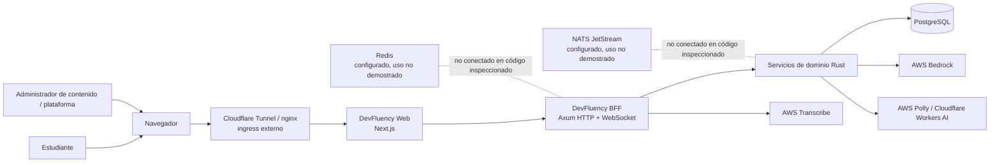
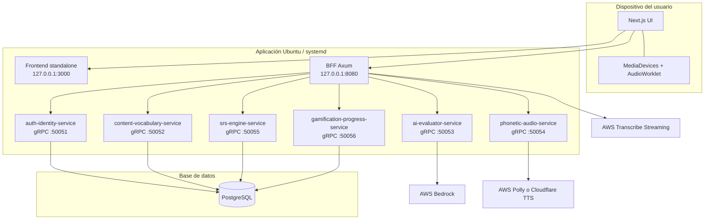
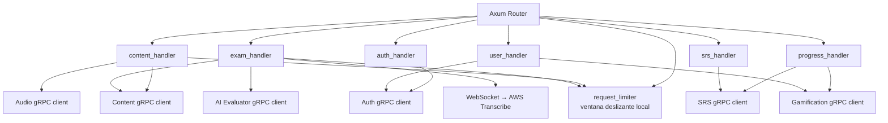
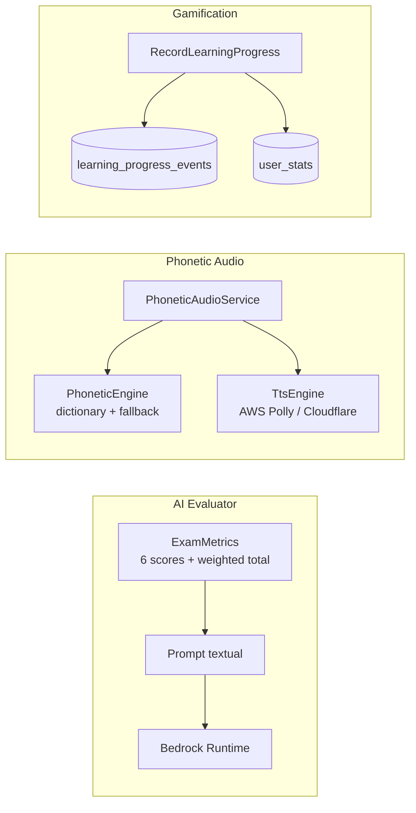

# Diagramas C4 — Fase 0

Los diagramas reflejan la arquitectura observada en el repositorio al 2026-11-01. Las cajas marcadas como configuradas/no conectadas no son dependencias de ejecución comprobadas. La topología externa Cloudflare Tunnel/nginx pertenece al entorno operativo descrito por el proyecto, pero no está definida dentro de estos archivos de aplicación.

## 1. Contexto

## 2. Contenedores / unidades desplegables

Los puertos de servicio se enlazan por defecto a loopback; la separación de VMs, direcciones privadas y túnel de ingress debe verificarse contra el EnvironmentFile y la infraestructura real antes de cambiar bind addresses.

## 3. Componentes del BFF y dominios

## 4. Componentes internos relevantes

## 5. Elementos fuera del alcance actual

No se dibujan Course/Lesson/Activity/Mastery, Conversation/Turn, Event Outbox ni Redis/NATS como contenedores conectados porque no se encontraron implementaciones activas suficientes. Deben añadirse a los diagramas cuando sean aprobados e implementados, con contratos y pruebas asociados.
